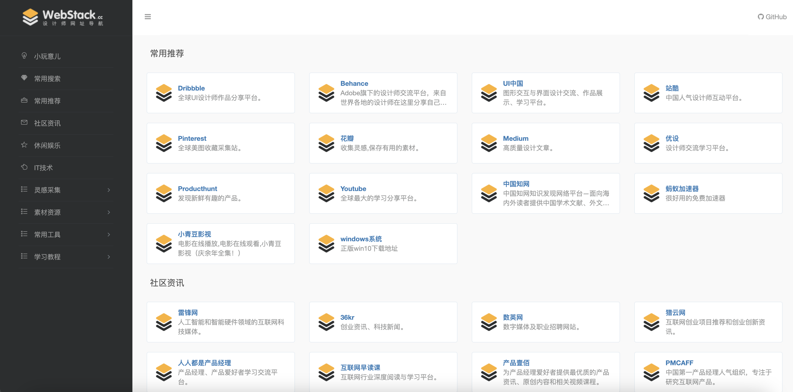
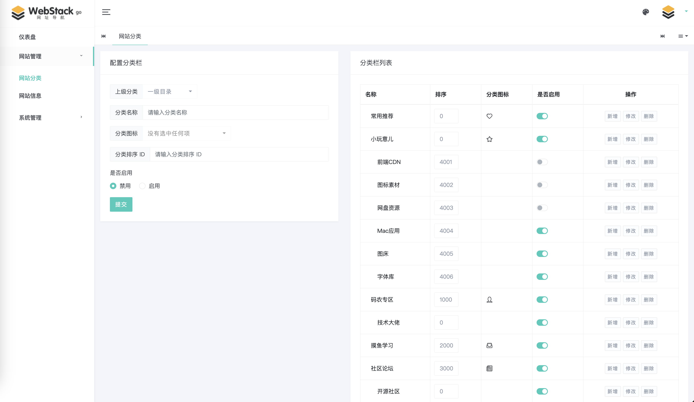
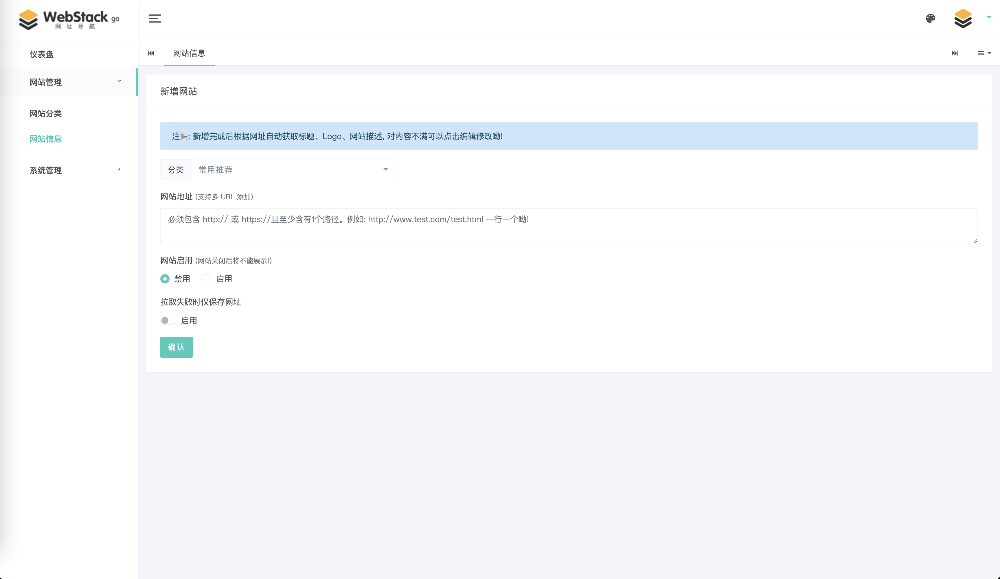
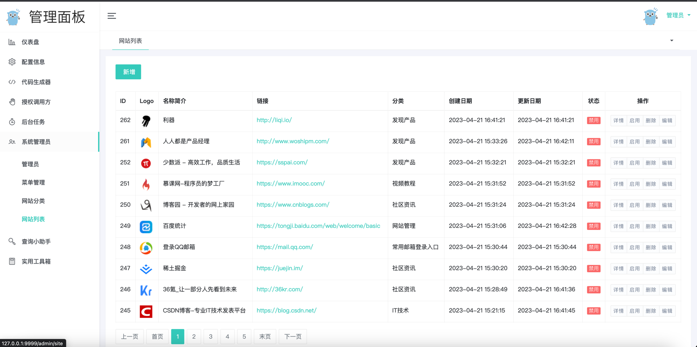
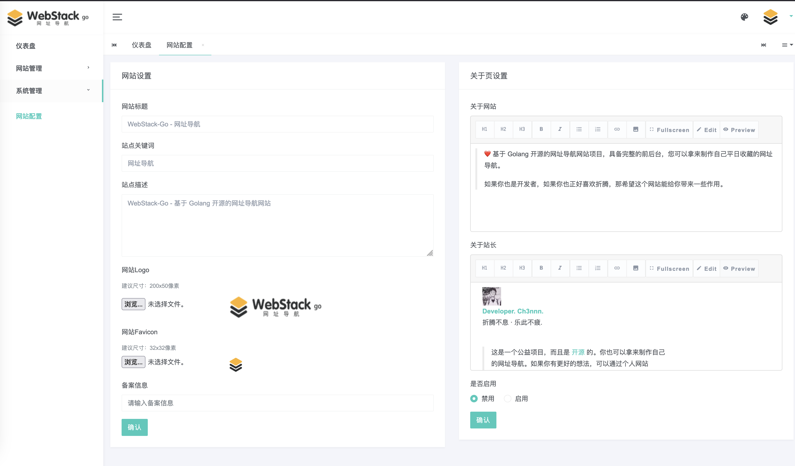

# webstack-go 网址导航后台系统

基于 Golang 开源的网址导航网站项目，具备完整的前后台，您可以拿来制作自己平日收藏的网址导航。
> v1: 使用 mysql 和 redis 组件, 丰富的后端功能。 v2: 简化版无需额外组件, 使用轻量级 sqlite 数据库。

- 前端模板: 公共站 [WebStackPage](https://github.com/WebStackPage/WebStackPage.github.io)（服务端渲染）；管理端 Vue 3 + TypeScript + Vite + Naive UI（SPA，构建产物内嵌进二进制）
- 后端框架: 基于 [go-nunu](https://github.com/go-nunu/nunu) 脚手架搭建

功能：
- [x] 新增 webstack - 导航首页
- [x] 新增 仪表盘 (SSE）
- [x] 新增 网站管理 - 网站分类
- [x] 新增 网站管理 - 网站列表
- [x] 新增 系统管理 - 自定义导航基本信息 (Logo、favicon、备案信息等）
- [x] 新增 支持批量添加 (自动获取标题、Logo、网站描述）
- [x] 新增 一键同步、导出功能
- [x] 新增 由 [gorm-gen](https://github.com/go-gorm/gen) 代码生成提供支持的友好且更安全的 GORM
- [x] 杂项 与仓库保持同步 [Docker Hub](https://hub.docker.com/r/ch3nnn/webstack-go/tags)

## 快速开始

### 一、运行环境

- Golang 1.23+（`go.mod` 的 go 指令是 1.23.0，1.22 无法编译）
- SQLite

> 管理端 SPA 的构建产物（`web/admin/dist`）已随仓库提交，`go build` 不需要 Node.js。
> 只有修改前端源码时才需要 Node.js 20+，见「三、管理端前端开发」。

### 二、启动服务

**1、二进制文件**

你可以直接从[ Releases ](https://github.com/ch3nnn/webstack-go/releases)下载预先编译好的二进制文件，解压后执行:

```bash
./webstack-go -conf config/prod.yml 
```

> [!NOTE]
> MacOS 在执行二进制文件时会提示：未打开“webstack-go”，因为 Apple 无法检查其是否包含恶意软件。
> 
> 可在“系统设置 > 隐私与安全性 > 安全性”中点击“仍然允许”，然后再次尝试执行二进制文件。


**2、源码运行服务 (需要 Golang 环境)**
1. 目录下执行 `go mod tidy` 拉取项目依赖库
2. 执行 `go build -o ./bin/server ./cmd/server` 编译项目，生成可执行文件 server 
3. 编译完执行 `./bin/server -conf=config/prod.yml` 首次启动程序之后，会生成 SQLite 数据库，并自动创建表结构

> 整个部署流程只需要 Go：前端产物 `web/admin/dist` 已在仓库里，`go build` 会把它内嵌进二进制，
> **不需要 `npm install` / `npm run build`**。只有改前端源码时才需要 Node.js（见第三节）。


**3、Docker 运行服务**
#### 下载镜像
1. docker run 运行
```bash
docker run -i -t --restart always -p 8000:8000 --name webstack-go -v ./data/storage:/data/app/storage ch3nnn/webstack-go:latest
```

2. docker compose (推荐)
```yaml
services:
  webstack-go:
    stdin_open: true
    tty: true
    restart: always
    ports:
      - 8000:8000
    container_name: webstack-go
    image: ch3nnn/webstack-go:latest
    volumes:
      - ./data/storage:/data/app/storage
```

#### 本地编译
1. 目录下执行 `make docker` 等待启动
   ```shell
   CONTAINER ID   IMAGE            COMMAND      CREATED         STATUS         PORTS                    NAMES
   5cb641ff3950 webstack-go:v2   "./server"   5 seconds ago Up 5 seconds 0.0.0.0:8000->8000/tcp webstack-go
   ```
2. docker container 正常运行后, 在浏览器中打开界面，链接地址：http://127.0.0.1:8000

## 三、管理端前端开发

管理端位于 `web/admin`，Vue 3 + TypeScript + Vite + Naive UI。产物 `web/admin/dist` 由 `web/assets.go` 的 `//go:embed admin/dist` 打进二进制，静态资源路径为 `/ui`，SPA 路由挂在 `/admin/*`，公共站（`/`、`/about`）仍是 Go 模板。

```bash
cd web/admin
npm ci
npm run dev      # http://127.0.0.1:5173，/api 与 /assets 代理到 127.0.0.1:8000
```

改完前端后必须重新构建并提交产物，否则二进制里仍是旧界面：

```bash
cd web/admin
npm run typecheck && npm run lint && npm run build
```

CI（`.github/workflows/web.yml`）会校验类型、lint，以及 `git diff --exit-code web/admin/dist`——产物与源码不一致会直接失败。

### 回滚

管理端前端已内嵌进二进制，**前端无法单独回滚**：回滚 = 换回上一个镜像 tag / 二进制版本。

## 效果图

> **首页**



> **网站分类**



> **新增网站**



> **网站信息**



> **网站配置**



## Star History

[](https://star-history.com/#ch3nnn/webstack-go&Date)
